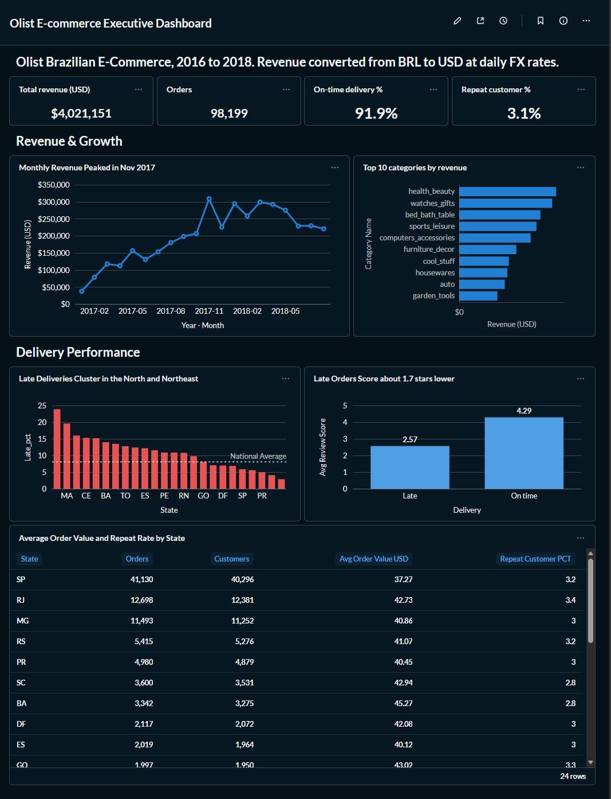
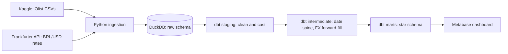
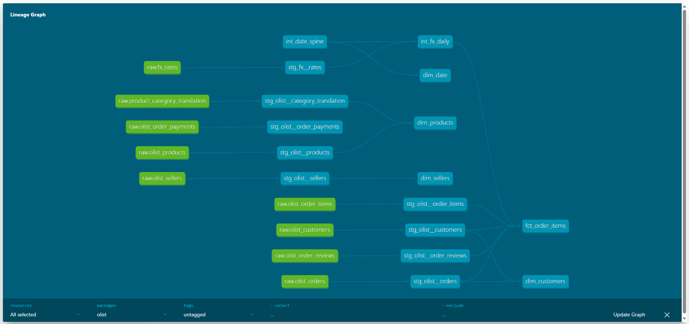

# Olist E-commerce Analytics Pipeline

An end-to-end ELT pipeline and dashboard built on the Brazilian Olist e-commerce dataset (~100K orders, 2016–2018). Python ingests raw data and live FX rates, DuckDB stores it, dbt models it into a tested star schema, and Metabase serves an executive dashboard.



## Business questions answered
1. **Revenue and growth:** which categories and months drive revenue?
2. **Delivery performance:** how does late delivery vary by state, and does it hurt reviews?
3. **Customer behavior:** how many customers come back, and what is the average order value by region?

## Key findings
- Revenue grew steadily through 2017, peaking in November 2017 (~$310K/month), then plateaued.
- 91.9% of delivered orders arrive on time, but late orders average **2.57 stars vs 4.29** for on-time orders.
- Late deliveries cluster in the north and northeast (AL, MA, PI, CE, SE at roughly 15–24%), while São Paulo, the largest market, is near 6%.
- Only **3.1%** of customers order more than once, so growth depends on new-customer acquisition.

## Architecture


| Layer | Tool | What it does |
|---|---|---|
| Ingestion | Python (`requests`, `duckdb`) | Downloads the 9 Olist tables and pulls daily FX rates via API; loads them untouched into `raw` |
| Storage | DuckDB | Local analytical warehouse (`raw`, `staging`, `intermediate`, `marts` schemas) |
| Transformation | dbt Core | 16 models, 36 data tests |
| BI | Metabase (Docker) | 4 KPIs and 5 charts |



## Data model
Star schema with one fact table at the order-item grain:

- **Fact:** `fct_order_items` — revenue in BRL and USD, delivery days, late flag, review score
- **Dimensions:** `dim_customers` (one row per real person, not per order), `dim_products`, `dim_sellers`, `dim_date`

## Engineering highlights
- **Raw data stays untouched.** Raw tables are loaded as text with a `_loaded_at` audit column; typing and cleaning happen in dbt. The ingestion script is idempotent.
- **Data quality tests** (uniqueness, not-null, accepted values, foreign-key relationships) caught a real issue: duplicate FX dates caused by API chunk boundaries. It was fixed in staging without touching raw data.
- **FX forward-fill:** the FX API returns business days only, so a model maps each calendar day to the latest available rate, so weekend orders convert correctly.
- **Review deduplication:** the dataset has repeated reviews per order; the fact table keeps the latest one.
- **Customer identity:** Olist issues a new `customer_id` per order, so the customer dimension keys on `customer_unique_id`, which is what makes repeat-purchase analysis possible.
- **Metric definitions:** revenue excludes canceled/unavailable orders; delivery metrics use delivered orders only; the monthly trend covers 2017-01 to 2018-08 because the surrounding months are incomplete.

## Example query
```sql
-- Late-delivery rate by customer state (order level)
with orders as (
    select distinct order_id, customer_unique_id, is_late
    from marts.fct_order_items
    where order_status = 'delivered' and is_late is not null
)
select c.state,
       round(100.0 * avg(case when o.is_late then 1 else 0 end), 1) as late_pct
from orders o
join marts.dim_customers c using (customer_unique_id)
group by 1
having count(*) >= 100
order by late_pct desc;
```
All dashboard queries are in [`sql/dashboard_queries.sql`](sql/dashboard_queries.sql).

## How to run
**Prerequisites:** Python 3.11+, Docker Desktop, a [Kaggle API token](https://www.kaggle.com/settings).

```bash
git clone https://github.com/<your-username>/olist-ecommerce-pipeline.git
cd olist-ecommerce-pipeline
python -m venv .venv
source .venv/bin/activate        # Windows: .venv\Scripts\Activate.ps1
pip install -r requirements.txt

# 1. Download the Olist CSVs into data/raw/ (or place them there manually) and load into DuckDB
python ingestion/ingest.py

# 2. Build and test the models (run dbt from inside dbt_project/)
cd dbt_project
dbt build
cd ..

# 3. Start Metabase
docker compose up -d
```
Open http://localhost:3001 and add a **DuckDB** database with file path `/data/olist.duckdb` (read-only).

**Notes**
- DuckDB allows one writer at a time: stop Metabase (`docker compose stop`) before running `dbt build`.
- `duckdb` is pinned to match the version supported by the Metabase DuckDB driver.

## Limitations and next steps
- Add PostgreSQL as a second dbt target for a multi-user warehouse.
- Schedule the pipeline with an orchestrator and add CI (`dbt build` on pull requests).
- Add incremental models and source freshness checks.

## Data and attribution
[Brazilian E-Commerce Public Dataset by Olist](https://www.kaggle.com/datasets/olistbr/brazilian-ecommerce) (CC BY-NC-SA 4.0); FX rates from the [Frankfurter API](https://frankfurter.dev). Raw data is not included in this repository.